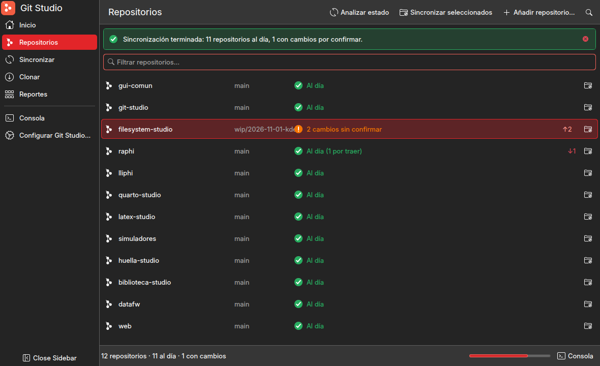
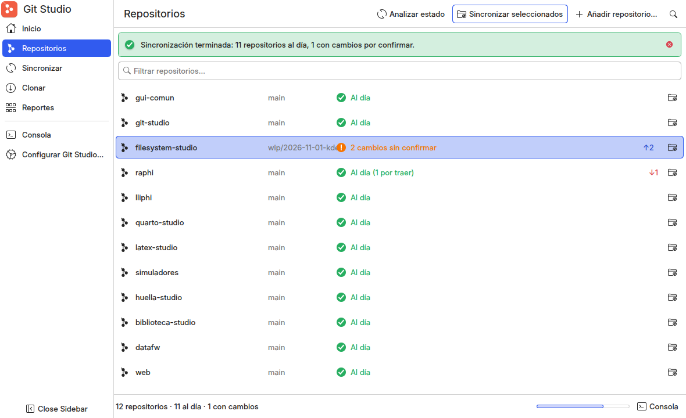

# Arquitectura QML + Qt Quick + Kirigami para los studios

Fase 1 del encargo replanteado por el autor el 2026-11-01: **auditar y proponer, no implementar**. Los ocho entregables
pedidos van en orden: diagnóstico (§1), comparación técnica (§2–3), arquitectura objetivo con diagrama (§4), evolución de
`gui-comun` (§5), referencias visuales (§6), prototipo conceptual del piloto (§7), plan con riesgos y esfuerzo (§8) y
decisiones que requieren aprobación (§9). Ningún studio ni `gui-comun` ha cambiado de código. Todo lo medido se midió en
esta máquina el 2026-11-01 (Kubuntu 26.04.1 LTS, Plasma 6.6.6); las rutas son relativas a `~/Documents/`.

## 0. Resumen para decidir

1. **La pila pedida existe, está instalada y funciona desde Python.** Qt 6.10.2, KDE Frameworks 6.24, Kirigami 6.24 y
   Kirigami Addons 1.11 (FormCard, TableView, TreeView, Delegates) cargan desde Python con el binding del sistema; lo
   probé con una sonda y con un prototipo de Git Studio que corre con el tema real del autor (§7, figuras).
2. **La condición es cambiar de Qt.** Kirigami es un módulo QML de KDE Frameworks compilado contra el Qt del sistema;
   el PySide6 de Anaconda (6.9.2, Qt propio) **no puede cargarlo** (`module "org.kde.kirigami" is not installed`, §2.3).
   Los studios deben correr con `/usr/bin/python3` y un binding de apt: `python3-pyside6.*` 6.10.2 (candidato, no
   instalado; conserva la API que ya usan los studios) o `python3-pyqt6` (instalado; con él se hizo la prueba).
3. **La lógica ya está separada de la interfaz en casi todos los studios** (servicios y modelos sin Qt o con solo
   QtCore; Raphi lo garantiza con una prueba): la migración es de la capa de presentación, no una reescritura (§1.2).
4. **Arquitectura objetivo**: Python = modelos (`QAbstractItemModel`), controladores (`QObject` con `@Slot`/`@Property`),
   servicios y workers; QML = toda la presentación sobre Kirigami; `gui-comun` 2.0 = paquete Python (núcleo) + módulo QML
   `GuiComun` (componentes) con la identidad de cada studio reducida a su marca (§4–5).
5. **Piloto: Git Studio**, confirmado por la auditoría y ya bocetado (§7). Esfuerzo total estimado: 45–55 jornadas de
   sesión repartidas en cinco fases, con el autor aprobando en tres puertas (§8).
6. **Bloqueo previo ajeno a la arquitectura: el disco está al 98 % (6 GB libres)**; instalar paquetes y correr sesiones
   anidadas de Plasma no cabe sin liberar espacio (D10).

## 1. Diagnóstico de la arquitectura actual (entregable 1)

### 1.1 Lo que hay

El detalle, con citas `archivo:línea`, está en `modernizacion-visual-kde.md` §1–4 (auditoría del marco y de los diez
studios, inventario de lo compartido y lo divergente). Lo que pesa para esta propuesta:

- **Diez aplicaciones Qt Widgets** (PySide6 6.9.2 de Anaconda) sobre `gui-comun` 1.4.0 (2 299 líneas): `Disenador`
  impone estilo Fusion, una paleta propia de tonos Tailwind, una hoja QSS de 160 líneas y un acento por studio; `Marco`
  pone una barra lateral fija, una paleta de órdenes, avisos flotantes y atajos literales; `montar_studio` oculta el
  menú. Resultado: aspecto de aplicación web sobre un Qt que **ya recibía** la paleta de Lliphi, Inter y Colloid.
- **Dos familias de ventana**: Filesystem y Git desde `.ui` (menú y acciones definidos y ocultos); los otros ocho a
  mano, con una clase envoltorio `Ventana` repetida siete veces. Quarto duplica consola, barra lateral y ajustes.
- **Sin Kirigami, sin QML en la interfaz** salvo una excepción: Lliphi Studio ya incrusta un `QQuickWidget` con el QML
  real del splash (`lliphi/studio/lliphi_studio/paginas/pantallas.py:230-238`).
- **Sin acciones estándar, sin iconos del tema, sin menús visibles, sin atajos configurables**; sí diálogos nativos,
  docks, barra de estado (en cuatro), pruebas `offscreen` y `--smoke` en los diez.

### 1.2 Cuánto está separada la lógica de la interfaz (lo que decide el esfuerzo)

| studio | lógica sin Qt o solo QtCore (se conserva tal cual) | interfaz a reescribir en QML | acoplamientos que hay que deshacer |
|---|---|---|---|
| Biblioteca | `acciones.py` (catálogo de acciones, bloqueo por Calibre/Zotero) | `ventana.py` 504 | la ventana construye los formularios de cada acción |
| Filesystem | `services/` 904 (árbol, carpetas, hardlinks, exportación), `models/extension_model.py` | 1 736 py + 763 `.ui` | controladores que leen widgets del `.ui` directamente |
| Git | `services/` 963 (git, estado, sync, clonado, config), `models/repo_status_model.py` | 1 261 py + 699 `.ui` | el modelo pinta colores con `QBrush` (pasa a roles semánticos) |
| Huella | `fases.py` (fases y enmascarado) | `ventana.py` 393 | SpiderFoot como proceso hijo desde la ventana |
| LaTeX | `compilador.py` (orden de la CLI, lectura del `.log`) | `ventana.py` 448 | `QFileSystemWatcher` y recientes dentro de la ventana |
| Quarto | `services/` (blogs, metadatos, posts, rutas), `workers/process_runner.py` | 1 811 | `settings.py` y consola propios; emojis en los textos |
| Raphi | `raphi/` entero (motor, fichas, recetas; **no importa PySide6**, lo prueba `tests/test_escritorio.py`), `familias.py` | `studio/` 1 000 | `formulario.py` genera widgets desde la ficha: pasa a generar `FormCard` |
| Lliphi | `proyecto.py`, `color.py`, `svgplasma.py`, `iconos.py` (lectura de temas) | 3 833 (páginas de editor con lienzos `QPainter`) | lienzos y resaltado: `QQuickPaintedItem` y `org.kde.syntaxhighlighting` |
| Simuladores | `laboratorio.py`, los modelos de `simuladores/*/modelos` | 674 | `FigureCanvasQTAgg` de matplotlib dentro de la página |
| Dotfiles | `estado.py` (stow, git, escáner) | `ventana.py` 405 | ninguno relevante |

La columna del medio suma ~11 000 líneas de interfaz Widgets. Las columnas primera y tercera son la medida real del
trabajo: la lógica se queda y los acoplamientos son pocos y conocidos.

## 2. Auditoría tecnológica (entregable 2, parte 1)

### 2.1 Versiones instaladas

| componente | versión | paquete | estado |
|---|---|---|---|
| Qt (sistema) | 6.10.2 | `libqt6core6`, `libqt6qml6`, `libqt6quick6` | instalado; trae `wayland`, `xcb`, Breeze, Kvantum y el tema de plataforma de KDE |
| Qt Quick Controls, Layouts, Dialogs, Templates, Qt.labs | 6.10.2 | `qml6-module-qtquick-*`, `qml6-module-qt-labs-*` | instalados |
| KDE Frameworks | 6.24.0 | `libkf6coreaddons6` y resto | instalados |
| Kirigami | 6.24.0 | `libkirigami6`, `qml6-module-org-kde-kirigami` | instalado |
| Kirigami Addons | 1.11.0 | `kirigami-addons-data`, `libkirigamiapp6` | instalado: `components`, `dateandtime`, `delegates`, `formcard`, `tableview`, `treeview` |
| Estilo de controles de KDE | 6.24.0 | `qml6-module-org-kde-desktop` (qqc2-desktop-style) | instalado: los controles QML con el estilo de widgets del sistema (Breeze/Kvantum) |
| Otros módulos QML de KDE útiles | 6.24 / 25.12 | `org.kde.syntaxhighlighting`, `org.kde.quickcharts`, `org.kde.kitemmodels`, `org.kde.iconthemes`, `org.kde.notification`, `org.kde.sonnet`, `org.kde.kquickcontrols` | instalados |
| Plasma | 6.6.6 | `plasmashell` | Wayland |
| Traducciones | es | `language-pack-kde-es`, `libkirigami6_qt.qm`, `kirigami-addons6.mo` | instaladas (hay que cargarlas desde Python, §7.3) |
| **PyQt6 (sistema)** | 6.10.2 | `python3-pyqt6`, `.qtqml`, `.qtquick`, `.sip` | **instalado**; sin `QtQuickControls2` en Python (el estilo se fija por `QT_QUICK_CONTROLS_STYLE`) |
| **PySide6 (sistema)** | 6.10.2 | `python3-pyside6.qtcore/.qtwidgets/.qtqml/.qtquick/.qtquickcontrols2/.qtquickwidgets` | **candidatos en apt, no instalados** |
| PySide6 (Anaconda) | 6.9.2 | pip/conda, Qt propio en `~/anaconda3/lib/qt6` | instalado; trae `QtQml`/`QtQuick`, **no** Kirigami ni `org.kde.desktop` |
| Herramientas QML | 6.9 (Anaconda) / 6.10 (sistema) | `qmllint`, `qmlformat`, `qml6`, `qmlscene`; `qt6-tools-dev-tools` | `qmlls` (servidor de lenguaje) no instalado |
| Python del sistema: dependencias de los studios | 3.x | `yaml` sí, `numpy` sí, `PIL` sí, `requests` sí; **`openpyxl`, `matplotlib`, `pandas`, `coloraide`, `markdown` no** | lo necesitan Quarto, Simuladores y Lliphi (§8.3) |

### 2.2 Compatibilidad probada

Sonda `Main.qml` (Kirigami.ApplicationWindow + GlobalDrawer + ScrollablePage + FormCard + TableView) cargada con
`QQmlApplicationEngine` desde Python:

| binding | plataforma | resultado |
|---|---|---|
| PyQt6 6.10.2 del sistema | `offscreen` | `KIRIGAMI_OK #e22529 #363636 Sans Serif` (carga; sin tema de plataforma la fuente es genérica) |
| PyQt6 6.10.2 del sistema | `xcb` (sesión real) | `KIRIGAMI_OK #e22529 #363636 Inter`: acento y fondo de Lliphi Oscuro, fuente del autor |
| PySide6 6.9.2 de Anaconda | cualquiera | `module "org.kde.kirigami" is not installed`, `module "org.kde.desktop" is not installed` |

El prototipo de Git Studio (§7) confirma lo mismo con `GlobalDrawer`, `InlineMessage`, `SearchField`, delegados de
Addons, `OverlayDrawer`, iconos del tema y colores semánticos de `Kirigami.Theme`, en Lliphi Oscuro y en Lliphi Claro
(este último con un `kdeglobals` temporal vía `XDG_CONFIG_HOME`, sin tocar el escritorio).

### 2.3 Dependencias y conflictos

- **El Python por omisión es el de Anaconda** (`which python3` → `~/anaconda3/bin/python3`): cada `main.py`, `install.sh`,
  `suite.yml` y `.desktop` debe invocar `/usr/bin/python3` explícitamente, o un `.venv --system-site-packages` creado
  desde él (el patrón que Raphi ya usa para su `.venv`).
- **Kirigami no se instala con pip**: depende de KDE Frameworks y del Qt de la distribución. Un usuario de Raphi o de
  Lliphi Studio fuera de KDE necesita `qml6-module-org-kde-kirigami` de su distribución (existe en Debian/Ubuntu, Fedora,
  Arch, openSUSE) y un binding del sistema; en Windows y macOS no hay vía razonable. Esto limita a dónde se publica.
- **Dependencias Python de tres studios** no están en el Python del sistema (§2.1): `openpyxl` (Quarto), `matplotlib`,
  `pandas` (Simuladores), `coloraide`, `markdown` (Lliphi). Solución: `.venv --system-site-packages` por studio con esas
  dependencias por pip, o sus paquetes `python3-*` de apt.
- **Acoplamiento a la versión de Kubuntu**: Kirigami 6.24 y Addons 1.11 son los de 26.04 LTS; la API documentada es
  estable dentro de KF6, pero Addons cambia más (p. ej. `TableView` es reciente). Regla: usar solo lo documentado en
  `api.kde.org` y fijar la versión mínima en `gui-comun`.
- **Accesibilidad**: Qt Quick exige declarar `Accessible.name`/`Accessible.role` en los elementos propios (Kirigami y
  QQC2 ya lo traen en los suyos); Widgets lo daba gratis. Es trabajo de la galería (§5.4).
- **Pruebas**: `offscreen` funciona con Kirigami (probado), pero sin tema de plataforma: las pruebas verifican
  estructura y modelos, no colores; Qt Quick Test no es accesible desde Python, así que las pruebas de QML se hacen
  cargando cada página en un `QQmlApplicationEngine` y comprobando `rootObjects()` y propiedades.
- **Wayland**: con el Qt del sistema los studios corren en Wayland nativo (adiós a `preparar_plataforma()` y XWayland),
  con escalado fraccional de Plasma y decoraciones del servidor.
- **Disco**: 6 GB libres; `python3-pyside6` completo son ~150 MB, los paquetes de desarrollo QML otros tantos; cada
  sesión anidada de Plasma de Lliphi deja cientos de MB en `~/.cache/lliphi/sesiones/` (4,3 GB hoy). Ver D10.

## 3. Comparación técnica de alternativas (entregable 2, parte 2)

| criterio | A · Qt Widgets + Breeze/Kvantum (propuesta anterior) | B · Qt Quick + QQC2 (`org.kde.desktop`) sin Kirigami | **C · Qt Quick + Kirigami + Addons** | D · Widgets anfitrión + islas `QQuickWidget` | E · C++ (KXmlGui, KWidgetsAddons) |
|---|---|---|---|---|---|
| Integración KDE (paleta, fuentes, iconos, diálogos, cambio en vivo) | alta con el Qt del sistema | alta (`Kirigami.Theme` no, pero `SystemPalette` y `org.kde.desktop` sí) | **máxima**: `Kirigami.Theme`, `Units`, iconos, `GlobalDrawer`, `InlineMessage`, patrones de KDE | alta en el anfitrión; dos mundos por ventana | máxima |
| Modernidad visual (fluidez, animaciones, transiciones, adaptabilidad) | baja: lo que el estilo da | media: hay que diseñar todo | **alta de serie**: transiciones de `pageStack`, cajones, unidades, columnas adaptables | media | baja |
| Patrones de aplicación listos (navegación, formularios, tablas, mensajes, ajustes) | `QMainWindow` y poco más | ninguno: todo propio | **FormCard, TableView, TreeView, Delegates, ConfigurationView, SearchField, Action, PageRow** | los de A | KXmlGui |
| Esfuerzo de migración desde lo actual | medio (reescribir el marco, conservar páginas) | alto (reescribir todo sin patrones) | **alto en interfaz, bajo en lógica** (§1.2): ~11 000 líneas de Widgets a QML, con patrones que acortan | medio, pero deja deuda doble | muy alto (otro lenguaje) |
| Madurez desde Python | alta | alta (Qt Quick es Qt) | **alta para el uso que toca**: Kirigami se consume desde QML; Python solo expone modelos y objetos; sin binding C++ necesario | alta | n/a |
| Rendimiento | alto | alto (escena GPU) | alto; listas grandes con `ListView` + modelos; cuidado con `Repeater` masivos | doble pila de render | alto |
| Wayland y HiDPI | sí con el Qt del sistema | sí | **sí** (`Kirigami.Units` escala con la fuente) | sí | sí |
| Accesibilidad | gratis en widgets estándar | manual en lo propio | manual en lo propio; Kirigami y QQC2 la traen | mixta | gratis |
| Tablas, árboles, exploradores | **las mejores** (`QTableView`, `QTreeView`, `QFileSystemModel`) | `TableView`/`TreeView` de Qt Quick, a mano | `Addons.TableView` (ListTableView), `TreeView` de Addons, `QFileSystemModel` sirve como modelo | las de A | las de A |
| Texto, consola, código, diff | `QPlainTextEdit` fuerte | `TextArea` básica | `TextArea` + **`org.kde.syntaxhighlighting`** (instalado): resaltado de diff, log, JSON, QML | las de A | KTextEditor |
| Gráficos (Simuladores) | matplotlib incrustado | `org.kde.quickcharts` o imagen | **`org.kde.quickcharts`** (instalado) o matplotlib renderizado a imagen vía `QQuickImageProvider` | matplotlib | KChart |
| Mantenibilidad y coherencia entre diez apps | buena | depende del rigor propio | **buena**: un módulo `GuiComun` sobre Kirigami; cada página es un `.qml` declarativo | mala (dos tecnologías por app) | buena, pero fuera del equipo |
| Riesgo de dependencias | bajo | bajo | medio: KF6 de la distribución; fuera de Linux no hay | bajo | alto |
| Pruebas | `pytest` + `offscreen` (hay) | `offscreen` + carga de QML | **`offscreen` + carga de QML + pruebas de modelos en Python** | ambas | CTest |
| Veredicto | descartada por el autor como tecnología principal (brief §7); se conserva su diagnóstico | descartada: reinventa lo que Kirigami ya trae | **recomendada** | **solo como transición** en Lliphi (lienzos `QPainter` → `QQuickPaintedItem`) y en Raphi (ventana web) | descartada: sin justificación de rendimiento ni integración (brief §1, §7) |

Opción F, web incrustada (`QWebEngineView`): descartada por el brief (§2) salvo la ventana `--web` de Raphi, que es
otro producto (la web de Raphi en el escritorio) y se queda como está (D7).

## 4. Arquitectura objetivo (entregable 3)

### 4.1 Capas

```text
┌──────────────────────────────── Studio (p. ej. git-studio/studio) ───────────────────────────────┐
│  qml/Main.qml · qml/paginas/*.qml  — presentación declarativa; cero lógica de negocio           │
│  <app>/controladores/*.py  — QObject con @Property/@Slot/Signal: lo que QML ve del studio        │
│  <app>/modelos/*.py        — QAbstractListModel / QAbstractTableModel / QSortFilterProxyModel    │
│  <app>/servicios/*.py      — lo que ya existe: git, estado, sync, clonado, config (sin Qt)       │
│  main.py                   — /usr/bin/python3: GuiComun.Aplicacion(...).ejecutar("Main.qml")     │
└───────────────┬──────────────────────────────────────┬───────────────────────────────────────────┘
                │ import GuiComun (QML)                │ from gui_comun import … (Python)
┌───────────────▼──────────────────────┐  ┌────────────▼────────────────────────────────────────────┐
│  GuiComun (módulo QML, en gui-comun) │  │  gui_comun (paquete Python, en gui-comun)               │
│  StudioWindow · Navegacion · PaginaInicio │  nucleo.Aplicacion (motor QML, rutas de import, traducciones, │
│  PaginaLista · PaginaFormulario ·    │  │    estilo org.kde.desktop, nombre de escritorio)          │
│  Consola · Mensajes · PaletaOrdenes ·│  │  acciones.Acciones (registro expuesto a QML)               │
│  Tareas · DialogoAjustes · Marca     │  │  tareas.Tareas (workers → progreso, cancelación, consola)  │
│  (todo sobre Kirigami/Addons/QQC2;   │  │  ajustes.Ajustes (QSettings expuesto)                      │
│   sin colores ni fuentes propios)    │  │  consola.ModeloConsola · lanzador (sin cambio)             │
└───────────────┬──────────────────────┘  └────────────┬────────────────────────────────────────────┘
                │                                      │
┌───────────────▼──────────────────────────────────────▼────────────────────────────────────────────┐
│  org.kde.kirigami 6.24 · org.kde.kirigamiaddons.* 1.11 · QtQuick.Controls (org.kde.desktop) ·      │
│  org.kde.syntaxhighlighting · org.kde.quickcharts · org.kde.kitemmodels                           │
├───────────────────────────────────────────────────────────────────────────────────────────────────┤
│  Qt 6.10 del sistema (wayland, Breeze/Kvantum, KDEPlasmaPlatformTheme6) · PySide6/PyQt6 del sistema │
├───────────────────────────────────────────────────────────────────────────────────────────────────┤
│  KDE Plasma 6.6 · Lliphi (esquema de color, fuentes, iconos Colloid) · xdg-desktop-portal         │
└───────────────────────────────────────────────────────────────────────────────────────────────────┘
```

Diagrama de componentes (Mermaid, se renderiza en Obsidian):

```mermaid
flowchart LR
  subgraph Studio
    QML[qml/Main.qml + paginas/*.qml]
    CTL[controladores (QObject)]
    MOD[modelos (QAbstractItemModel)]
    SRV[servicios existentes (sin Qt)]
    CLI[CLIs y backends del repo]
  end
  subgraph gui-comun
    GQ[GuiComun (módulo QML)]
    GP[gui_comun (Python): nucleo · acciones · tareas · ajustes · consola · lanzador]
  end
  KIR[Kirigami · Addons · QQC2 org.kde.desktop · syntaxhighlighting · quickcharts]
  QT[Qt 6.10 del sistema + PySide6/PyQt6 del sistema]
  KDE[Plasma 6.6 · Lliphi · portal]
  QML --> GQ --> KIR --> QT --> KDE
  QML -. propiedades y señales .-> CTL
  CTL --> MOD
  CTL --> SRV --> CLI
  CTL --> GP
  GP --> QT
```

### 4.2 Reglas de la frontera Python ↔ QML

1. **QML no ejecuta procesos ni lee archivos**; pide al controlador (`@Slot`) y observa propiedades y modelos.
2. **Python no construye interfaz**: ni widgets, ni `setStyleSheet`, ni colores; expone datos y estado.
3. **Datos tabulares, siempre un modelo** con roles con nombre (`roleNames`), filtrado y orden con
   `QSortFilterProxyModel` o `org.kde.kitemmodels` (`KSortFilterProxyModel` desde QML).
4. **Tareas largas** por `gui_comun.tareas` (los `FunctionWorker`/`ProcessWorker` actuales envueltos en un `QObject`
   con `progreso`, `linea`, `terminada`, `cancelar()`); la consola es un modelo que QML pinta con resaltado.
5. **Estado semántico, no color**: un repo «con cambios» es `limpio: false`; el color lo pone QML con
   `Kirigami.Theme.neutralTextColor`. Nunca un hexadecimal en Python ni en QML (salvo datos de dominio de Lliphi).
6. **Acciones**: `gui_comun.acciones` registra nombre, texto, icono freedesktop, atajo (`StandardKey` cuando lo hay) y
   grupo; QML las instancia como `Kirigami.Action` en cajón, cabecera de página, menús contextuales y paleta de órdenes.
7. **Ajustes** por `QSettings` (como hoy), expuestos como propiedades; el diálogo es `Addons.ConfigurationView`.
8. **Traducción**: cadenas en español en el código; las de Kirigami y Addons se cargan de los `.qm`/`.mo` instalados
   (§7.3). Nada de `qsTr` con inglés de origen.
9. **Instancia única, esquemas de URL, bandeja, menús de Dolphin, arrastrar y soltar**: lo que ya existe (Biblioteca,
   Raphi, LaTeX) se conserva en Python y se conecta a QML por señales (`DropArea` en QML para soltar).

### 4.3 Estructura de carpetas de un studio migrado

```text
<studio>/studio/
  main.py                     # /usr/bin/python3; sin lógica
  <app>/__init__.py           # localiza gui_comun (instalado o ../gui-comun)
  <app>/aplicacion.py         # arma Aplicacion, registra controladores y modelos, carga qml/Main.qml
  <app>/controladores/        # QObject por página o por dominio
  <app>/modelos/              # QAbstractItemModel
  <app>/servicios/            # lo que ya existe (sin cambios)
  <app>/qml/Main.qml          # StudioWindow { marca; paginas: [...] }
  <app>/qml/paginas/*.qml     # una página por archivo
  <app>/qml/componentes/*.qml # solo lo propio del studio
  <app>/recursos/             # icono de marca (SVG) y nada más
  tests/                      # pytest: modelos, controladores, carga de cada .qml en offscreen, --smoke
```

## 5. Evolución de `gui-comun` (entregable 4)

### 5.1 De 1.4.0 (Widgets) a 2.0 (QML) sin romper a nadie

`gui-comun` 2.0 **añade** el paquete QML y el núcleo nuevo y **congela** `gui_comun.widgets`, `diseno`, `theming` y
`marco` tal como están (sin mejoras: solo correcciones) hasta que el último studio migre; entonces 3.0 los retira. Un
studio migrado no importa nada de `widgets`; uno sin migrar no nota el 2.0. Es la regla del repo (se añade sin
quitar; lo que cambia sube la mayor con migración) aplicada a una migración larga.

| pieza de 1.x | en 2.0 (QML + Python) | base en Kirigami/Addons |
|---|---|---|
| `Disenador`, tokens, acentos, QSS | **desaparece**; `Kirigami.Theme` y `Kirigami.Units`; el acento por studio queda solo en `Marca` (icono) | `Kirigami.Theme.highlightColor`, `positiveTextColor`, `neutralTextColor`, `negativeTextColor`, `activeTextColor`, `disabledTextColor`, `defaultFont`, `fixedWidthFont`; `Units.smallSpacing/largeSpacing/gridUnit/iconSizes` |
| `Marco` (barra lateral, pie, atajos) | `GuiComun.StudioWindow` + `GuiComun.Navegacion` | `Kirigami.ApplicationWindow`, `GlobalDrawer` (plegable, no modal en escritorio), `PageRow` |
| `montar_studio` | `gui_comun.nucleo.Aplicacion(marca, acciones, paginas)` | `QQmlApplicationEngine`, `addImportPath`, `QQuickStyle` |
| `Paleta`/`Comando` | `GuiComun.PaletaOrdenes` alimentada por `acciones.Acciones` | `Kirigami.SearchDialog` (Addons `components`) o `Kirigami.OverlaySheet` + `ListView`; atajos Ctrl+Alt+I y Ctrl+K |
| `Avisos` (toasts) | `GuiComun.Mensajes` | `Kirigami.InlineMessage` (positivo, información, aviso, error) y `showPassiveNotification` para lo efímero; `org.kde.notification` para el sistema |
| `ConsoleDock` | `GuiComun.Consola` (cajón inferior) + `gui_comun.consola.ModeloConsola` | `Kirigami.OverlayDrawer` abajo; `TextArea` con `org.kde.syntaxhighlighting` y `Kirigami.Theme.fixedWidthFont`; progreso y cancelar |
| chip de tarea | `GuiComun.Tareas` (progreso en el pie de página o en la cabecera) | `QQC2.ProgressBar`, `Kirigami.Action` cancelar |
| `tarjetas` (`Tarjeta`, `Cifra`, `Mosaico`, `ListaConVacio`) | `GuiComun.PaginaInicio` (herramientas en rejilla con filtro, recientes), `GuiComun.PaginaLista`, `GuiComun.PaginaFormulario` | `Kirigami.CardsLayout`/`Card` solo si el contenido lo pide; `Addons.FormCard` para formularios; `Kirigami.PlaceholderMessage` para listas vacías |
| `GraficoBarras` | `GuiComun.Grafico` | `org.kde.quickcharts` |
| `variante(primario|peligro)` | `Kirigami.Action` con `icon.name` y confirmación; el botón primario es el `highlighted` del estilo | `Kirigami.PromptDialog`, `Kirigami.Dialog` con `standardButtons` |
| diálogos de preferencias de cada studio | `GuiComun.DialogoAjustes` con secciones por studio | `Addons.ConfigurationView` + `FormCard` |
| `icono_trazo`, SVG propios | `icon.name` freedesktop (tabla en `modernizacion-visual-kde.md` §5.4); la marca de cada studio como único SVG propio | `Kirigami.Icon` |
| `lanzador`, `workers`, `ajustes`, `rutas`, `format`, `history_service` | sin cambio (los workers se envuelven en `tareas`) | — |
| `preparar_plataforma()` (XWayland) | desaparece: Wayland nativo con el Qt del sistema | — |

### 5.2 Identidad visual compartida (sin tokens de color propios)

- **Lo que se comparte**: la ventana (`StudioWindow`), la navegación, el inicio, los formularios (`FormCard`), las
  listas y tablas (delegados de Addons con la misma anatomía: icono · título · subtítulo · estado · acciones), los
  mensajes, la consola, la paleta de órdenes, el diálogo de ajustes, las unidades y las transiciones de Kirigami.
- **Lo que distingue a cada studio**: su marca (nombre, subtítulo, icono en losa con su acento —el único color propio,
  y solo en el icono—), sus páginas y su área de trabajo (árbol, tabla, editor, laboratorio), sus acciones.
- **Lo que no se hace**: colores, fuentes, radios, sombras o elevaciones propias; animaciones más allá de
  `Kirigami.Units.shortDuration/longDuration`; cajones modales en escritorio; «dashboards».
- **Tokens**: los de Kirigami. `gui-comun` no define paleta; define **anatomías** (qué va dónde) y **nombres** (los roles
  semánticos que un studio puede pedir).

### 5.3 Versionado y compatibilidad

- `gui-comun` 2.0.0: nace `GuiComun` (QML) y `gui_comun.nucleo/acciones/tareas/consola`; `widgets` congelado.
  2.x: componentes nuevos según los pidan los studios. 3.0.0: se retira `widgets`, `diseno`, `theming`, `marco`.
- Versión mínima declarada: Qt 6.8, KF6 6.10, Kirigami Addons 1.6 (lo que Kubuntu 26.04 y Debian 13 traen o superan);
  se comprueba al arrancar con un mensaje claro si falta un módulo QML.
- El módulo QML se publica dentro del paquete Python (`gui_comun/qml/GuiComun/`), con `qmldir`, y `Aplicacion` añade
  la ruta al motor; `pip install gui-comun` sigue bastando para quien tenga Kirigami.

### 5.4 Documentación y galería

- `docs/componentes.md` (referencia generada desde los `.qml` y sus docstrings) y **una galería** (`gui_comun/galeria`,
  al estilo de Kirigami Gallery) que muestra cada componente con datos de muestra en claro y oscuro: es el prototipo de
  alta fidelidad de la fase 2 y la prueba visual permanente.
- Pruebas: carga de cada `.qml` del módulo en `offscreen`; modelos y acciones en `pytest`; accesibilidad: cada
  componente propio declara `Accessible.name`.

## 6. Referencias visuales (entregable 5)

Aplicaciones Qt Quick + Kirigami de calidad profesional, y qué se toma de cada una. Las cuatro primeras están instaladas
en esta máquina y se pueden abrir ahora para comparar con el prototipo:

| aplicación | instalada | qué se toma |
|---|---|---|
| **Discover** (`plasma-discover` 6.6) | sí | cajón global con secciones y buscador, lista → detalle con `PageRow`, mensajes en línea, acciones en la cabecera de página, estados de carga |
| **Preferencias del sistema** (`systemsettings` 6.6) | sí | barra lateral con búsqueda y jerarquía, páginas `FormCard` (el patrón de nuestro diálogo de ajustes y de las páginas de opciones de LaTeX y Raphi) |
| **Elisa** (25.12) | sí | tres columnas adaptables, listas con delegados ricos, reproductor como pie de ventana (el patrón del pie con progreso) |
| **KDE Connect** (25.12) | sí | aplicación pequeña Kirigami: cajón, lista de dispositivos con estado, acciones contextuales |
| **Haruna** (1.7) | sí | Qt Quick + QQC2 `org.kde.desktop` con diálogo de ajustes Kirigami: muestra que un área de trabajo propia (el vídeo) convive con el marco de KDE |
| NeoChat | no | tres paneles, búsqueda global tipo paleta de órdenes, mensajes con tarjetas sobrias |
| Tokodon | no | línea de tiempo con delegados y acciones por fila |
| Merkuro (calendario, contactos) | no | barra lateral plegable, vistas múltiples de un mismo modelo, cajón de detalle |
| Itinerary, Kasts, Kalk, KClock, KWeather | no | formularios `FormCard`, listas con `PlaceholderMessage`, adaptabilidad a ventana estrecha |
| **Kirigami Gallery** (`kirigami-gallery`) | no (en apt) | la galería oficial de componentes: el modelo de nuestra galería (§5.4) |

Fuera de KDE, Qt Quick de calidad: los ejemplos de Qt Design Studio y las aplicaciones de Qt Company; no se toman como
referencia de identidad porque no siguen al escritorio. Pendiente D8: estas referencias y la HIG de KDE
(`develop.kde.org/hig`), la documentación de Kirigami y de Kirigami Addons (`api.kde.org`) entran en Calibre antes de
citarse en la fase 2.

## 7. Prototipo conceptual del piloto: Git Studio (entregable 6)

### 7.1 Qué es

Una ventana Kirigami con el modelo de repositorios en Python (`QAbstractListModel` con roles `nombre`, `rama`,
`adelante`, `atras`, `limpio`, `estado`, datos de muestra) y la página «Repositorios» completa: cajón global con las
cinco páginas y el pie (Consola F4, Configurar), cabecera con las acciones Analizar estado (F5), Sincronizar
seleccionados, Añadir repositorio (Ctrl+N) y Buscar (Ctrl+F), mensaje en línea positivo, campo de filtro, lista de repos
con icono, rama, estado con icono y color semántico (`positiveTextColor`/`neutralTextColor`), adelante/atrás, acción por
fila, pie con resumen, progreso y botón de consola, y la consola como cajón inferior con fuente fija del sistema.
~190 líneas de QML y ~65 de Python; cero colores propios. Corrió con PyQt6 del sistema sobre `xcb`, con el tema real.





### 7.2 Lo que demuestra

- Integración total con Lliphi sin configurar nada: acento `#e22529` en el oscuro y `#315bef` en el claro, fondos del
  esquema, Inter, iconos Colloid, cajón con la selección del sistema.
- Los patrones que el brief pide ya vienen: navegación lateral plegable, jerarquía de página, mensajes, búsqueda, lista
  con estados, acciones con atajos estándar, pie con progreso, cajón de consola.
- Python sigue mandando: el modelo y, en producción, `status_service` y `sync_service` tal como existen.

### 7.3 Lo que falta o salió mal (y se resuelve en la fase 3)

- «Close Sidebar» aparece en inglés: hay que cargar las traducciones de Kirigami (`libkirigami6_qt.qm`,
  `kirigami-addons6.mo`, instaladas) desde `Aplicacion` con `QTranslator`/`KLocalizedContext`.
- Anchos de columna fijos en el delegado (la rama se solapa con el estado): en producción la lista es
  `Addons.ListTableView` con columnas redimensionables.
- Sin paleta de órdenes, sin página de inicio, sin diálogo de ajustes, sin sincronización real: es un boceto de una
  página, no el piloto.
- El código del prototipo no está en ningún repo (vive en el área de trabajo temporal de la sesión); si el autor lo
  quiere conservar, el sitio es `gui-comun/galeria/` en la fase 2.

## 8. Plan, riesgos y esfuerzo (entregable 7)

Las cinco fases del brief, con puertas de aprobación del autor (P) y la medida de cada paso. Esfuerzo en jornadas de
sesión (una jornada = una sesión de trabajo del director con commit y `estado.md`).

| fase | qué | jornadas | riesgo | cómo se mide |
|---|---|---|---|---|
| **F1 Auditoría tecnológica** | este documento | hecha | — | **P1**: el autor decide D1–D10 |
| **F1b Entorno** | liberar disco (D10); instalar `python3-pyside6.*` (o fijar PyQt6), `kirigami-gallery`, `qmlls`; `.venv --system-site-packages` de prueba con las dependencias de Quarto, Simuladores y Lliphi; fijar `/usr/bin/python3` en `install.sh`/`suite.yml`/lanzador | 1–2 | bajo; el disco es el bloqueo real | la sonda y el prototipo corren con PySide6 del sistema; `pip check` en el `.venv` |
| **F2 Diseño del sistema visual** | `GuiComun` 2.0: `StudioWindow`, `Navegacion`, `PaginaInicio`, `PaginaLista`, `PaginaFormulario`, `Mensajes`, `Consola`, `Tareas`, `PaletaOrdenes`, `DialogoAjustes`, `Marca`; `gui_comun.nucleo/acciones/tareas/consola`; **la galería** con todos los componentes en claro y oscuro (prototipo de alta fidelidad); `docs/componentes.md`; pruebas | 8–10 | medio: es donde se fija el lenguaje; Addons `TableView`/`TreeView` son recientes (se prueban con modelos reales de Git y Filesystem) | galería corriendo en Lliphi Claro y Oscuro con cambio en vivo; pruebas `offscreen`; **P2**: el autor aprueba la galería antes del piloto |
| **F3 Studio piloto: Git Studio** | reescribir `studio/` según §4.3: 5 páginas, acciones, ajustes, consola real con `sync.sh`, clonado, reportes; conservar `services/` y `tests/`; `.desktop` y `install.sh` | 5–6 | medio: primer contacto de los servicios con controladores QML; `QInputDialog`/`QMessageBox` pasan a `Kirigami.PromptDialog` | las 7 pruebas actuales (adaptadas a `QQmlApplicationEngine`) y `--smoke`; paridad funcional página por página con capturas antes/después; **P3**: el autor valida rendimiento, accesibilidad (teclado completo, `Accessible.name`), Wayland y comportamiento |
| **F4 Biblioteca compartida** | lo aprendido en F3 vuelve a `GuiComun` (2.1): componentes que faltaron, API de controladores estabilizada, plantilla de studio (`cookiecutter` interno), versionado (§5.3) | 3–4 | bajo | galería y pruebas; `CHANGELOG` 2.1 |
| **F5 Migración progresiva** (uno por uno, cada uno con sus pruebas y capturas) | Filesystem (gemelo de Git; `QFileSystemModel` + `Addons.TreeView`) 5 · Dotfiles 2 · Huella 2 · LaTeX 3 (soltar, vigilancia, errores en lista) · Biblioteca 3 (instancia única y esquema de URL se conservan) · Quarto 5 (absorbe su consola y ajustes; asistente APAQuarto como `FormCard` por pasos) · Simuladores 4 (`quickcharts` o imagen matplotlib) · Raphi 6 (formularios generados desde fichas → `FormCard` generado; ventana web intacta) · Lliphi 9–11 (lienzos a `QQuickPaintedItem`, `QQuickWidget` → `Loader`, resaltado con `syntaxhighlighting`; es el escaparate) | 39–41 | medio en Raphi (público) y alto en Lliphi (tamaño y lienzos) | cada studio: pruebas, `--smoke`, paridad funcional, capturas, `estado.md`; Raphi: su prueba «ninguna pantalla a mano» se mantiene (las páginas se generan de las fichas) |
| **F6 Cierre** | `gui-comun` 3.0 (retira Widgets), `workspace.yml` y derivados, `CLAUDE.md`/`README` de cada repo, este documento a `hecho` | 2 | bajo | doctor, validador, `workspace.py verificar` |

Total: **58–66 jornadas** contando F1b y F6; 45–55 de trabajo de interfaz propiamente (F2–F5). Orden de F5 pensado
para que lo pequeño confirme la plantilla antes de los tres grandes.

### 8.1 Riesgos y mitigaciones

| riesgo | probabilidad | impacto | mitigación |
|---|---|---|---|
| Disco lleno impide instalar y probar | alta (6 GB) | bloquea F1b | D10 antes de todo; las sesiones anidadas de Lliphi se limpian tras cada uso |
| Dependencias Python fuera del Python del sistema | segura (openpyxl, matplotlib, pandas, coloraide, markdown) | Quarto, Simuladores, Lliphi | `.venv --system-site-packages` por studio (patrón de Raphi) o paquetes apt |
| Kirigami Addons cambia API entre versiones | media | componentes de tabla y árbol | fijar mínimos, usar lo documentado, galería como prueba de regresión |
| Accesibilidad peor que en Widgets | media | lectores de pantalla, teclado | `Accessible.*` obligatorio en la galería; navegación por teclado probada en P3 |
| Pruebas QML limitadas desde Python | segura | cobertura | modelos y controladores en `pytest`; carga de cada `.qml` en `offscreen`; capturas comparadas a mano en cada puerta |
| Dos marcos conviviendo durante meses (Widgets 1.x y QML 2.x) | segura | deuda temporal | `widgets` congelado, sin mejoras; orden de migración corto para los pequeños; 3.0 lo cierra |
| Lliphi: lienzos `QPainter` y `QQuickWidget` | alta | el studio más grande | `QQuickPaintedItem` conserva el código de pintura; migrar página a página con su prueba |
| Raphi fuera de KDE (usuarios externos) | media | distribución | documentar la dependencia de `qml6-module-org-kde-kirigami`; la ventana `--web` sigue siendo la vía sin Kirigami |
| Curva de aprendizaje QML del propio equipo (sesiones) | media | ritmo | plantilla de studio y galería como ejemplos canónicos; `qmllint`/`qmlformat` en las pruebas |
| Rendimiento con listas grandes (Filesystem) | baja | explorador | `ListView`/`TreeView` con modelos perezosos (`QFileSystemModel` ya lo es) |

## 9. Decisiones que requieren aprobación del autor (entregable 8)

| id | decisión | recomendación |
|---|---|---|
| D1 | Tecnología principal: **Qt Quick + Kirigami + Kirigami Addons** (opción C), con QQC2 `org.kde.desktop`; Qt Widgets solo como transición en islas (`QQuickPaintedItem` en Lliphi) | sí |
| D2 | Binding: **PySide6 del sistema** (`python3-pyside6.*` 6.10.2 de apt; conserva la API de los studios y de `gui_comun.workers`) frente a PyQt6 del sistema (instalado, probado hoy, licencia GPL/comercial); todos los studios con `/usr/bin/python3` o `.venv --system-site-packages` | PySide6 del sistema; PyQt6 como respaldo verificado |
| D3 | Coexistencia: `gui-comun` 2.0 añade QML y congela `widgets` hasta la última migración; 3.0 los retira | sí |
| D4 | Piloto: **Git Studio** (confirmado por §1.2 y §7); Filesystem segundo | sí |
| D5 | Identidad: sin tokens de color propios; `Kirigami.Theme`/`Units`; el acento por studio solo en el icono de marca; animaciones las de Kirigami | sí |
| D6 | Consola, diff y código con `org.kde.syntaxhighlighting`; gráficos de Simuladores con `org.kde.quickcharts` (matplotlib renderizado a imagen como alternativa si un gráfico no cabe) | sí |
| D7 | Raphi: la ventana web (`QWebEngineView`, `--web`) se conserva; el studio nativo migra | sí |
| D8 | Fuentes a Calibre antes de citarlas: HIG de KDE, documentación de Kirigami y Addons, Qt Quick, especificación de iconos freedesktop (R11) | sí, en F1b |
| D9 | Sede: este documento y las figuras en `gui-comun/docs/` (repo público; menciona `core/`, `meta/` y rutas de esta máquina pero nada sensible) o en `meta/` | aquí; en F6 queda `docs/componentes.md` como referencia pública |
| D10 | **Disco**: liberar espacio antes de F1b. Lo medido hoy (laptop, `/` al 98 %): `~/.config/Claude/vm_bundles/claudevm.bundle` 12 GB (la máquina virtual del Code tab de la app de Claude), `~/.cache/lliphi/sesiones` 4,3 GB (sesiones anidadas de Plasma de hoy), imágenes Docker 4,3 GB reclamables (`docker system df`), `~/.claude/projects` 4 GB (transcripciones), Chrome 5,2 GB, snaps 4,8 GB, Anaconda 11 GB. **Los respaldos del ecosistema no están en la laptop**: `RESPALDOS_DIR` es el disco externo ARCHDISK (150 GB allí). Nada se borra sin el autor | el autor decide qué va: lo reclamable sin pérdida son Docker (`docker system prune`), las sesiones de Lliphi y las cachés |

Hasta que el autor decida, no se cambia código en ningún studio ni en `gui-comun`. El pendiente está en
`gui-comun/estado.md` §Por hacer.

## 10. Evidencia y método

- Inventario con `dpkg -l`, `apt-cache policy`, `ls` de `/usr/lib/x86_64-linux-gnu/qt6/qml/org/kde`,
  `QLibraryInfo` del PySide6 de Anaconda, `importlib` en `/usr/bin/python3`.
- Sonda QML (`Kirigami.ApplicationWindow` + Addons) con PyQt6 del sistema en `offscreen` y `xcb`, y con PySide6 de
  Anaconda; prototipo de Git Studio capturado con `QQuickWindow.grabWindow()` en Lliphi Oscuro (sesión real) y Lliphi
  Claro (`XDG_CONFIG_HOME` temporal con el esquema de `lliphi/generado/esquema/LliphiClaro.colors`).
- Uso de disco con `df` y `du -x` sobre `$HOME`, `/usr`, `/var` y `docker system df`; `core/env.sh` para `RESPALDOS_DIR`.
- Diagnóstico de la arquitectura actual: `modernizacion-visual-kde.md` §1–4 (misma fecha).
